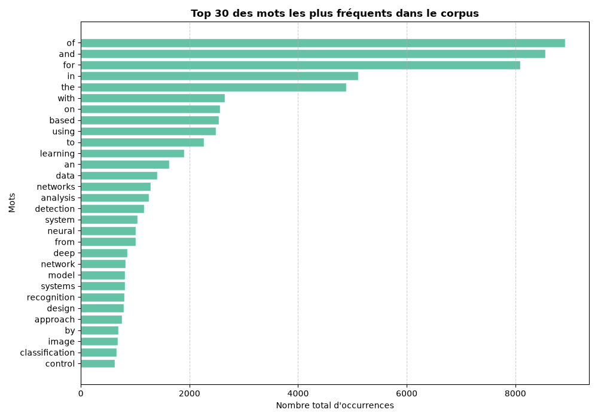
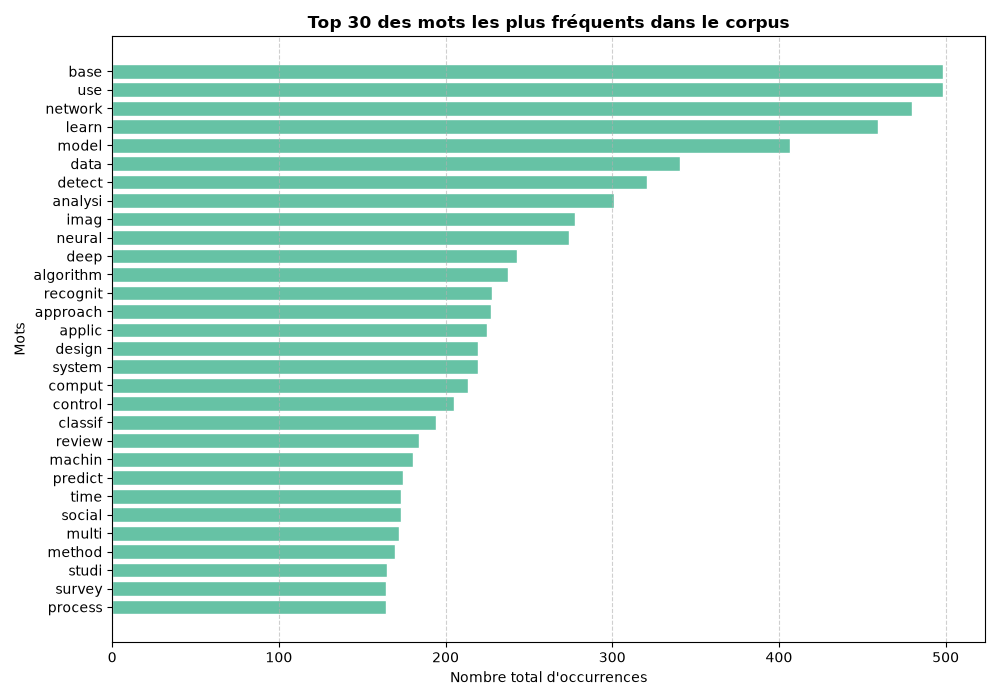

# Moteur de recherche dans la littérature scientifique

> **MOD 7.2 : Introduction à la science des données** (BE séances 4, 5 et 6)  
> **Groupe**: Raphaël Davin, Maxence Dordenart, Mathis Frinzi

---

## Présentation du sujet

Ce projet consiste à concevoir un **moteur de recherche sémantique** appliqué à un corpus de plus de 25 000 publications scientifiques.

Étant donnée une publication requête $q$, l'algorithme doit attribuer un score d'appariement $S(q, c)$ à un ensemble d'articles candidats $C$ composé de :

- **5 articles cités** par la publication requête (exemples positifs $C^+$) ;
- **~25 articles aléatoires** issus du corpus (exemples négatifs $C^-$).

L'objectif est de faire remonter préférentiellement les 5 citations pertinentes en tête de classement, en explorant progressivement plusieurs familles de représentations (**approches creuses**, **représentations denses** et **information de structure** via le graphe de citations).

---

## Prérequis et installation

Ce projet utilise [**uv**](https://docs.astral.sh/uv/) comme gestionnaire d'environnement et de dépendances Python (Python `3.13` spécifié dans `.python-version`).

### 2. Cloner le dépôt et installer les dépendances

```bash
git clone https://github.com/moons-of-iego/search-engine.git

# Crée automatiquement l'environnement .venv et installe les dépendances verrouillées
uv sync
```

### 3. Préparer les données

Assurez-vous que les fichiers de données (`corpus.jsonl`, `queries.jsonl`, `valid.tsv`) sont extraits dans le dossier `dataset/` à la racine du projet :

```bash
unzip dataset.zip -d dataset
```

---

## Utilisation (branche maxence)

Les scripts et modules peuvent être exécutés directement dans l'environnement géré par `uv` (sans activation manuelle du `.venv`) :

```bash
# Lancer le point d'entrée principal
uv run main.py

# Exécuter un module spécifique de src/
uv run -m src.analyser
uv run -m src.encoder
uv run -m src.comparator
uv run -m src.engine
```

> Au premier lancement, `src/loader.py` sérialise automatiquement les fichiers bruts en format binaire (`.pkl`) dans `.cache/` afin d'accélérer les exécutions suivantes.

---

## Détail du code développé

### Chargement des données

Le chargement est réalisé par la fonction `load_dataset` du module `src.loader`. Celui-ci créé un cache (format `pickle`) et appelle le cache s'il existe dans toutes les utilisations ultérieures de la fonction de chargement.

### Analyse des données

L'analyse est réalisée par le module `src.analyser`. L'analyse se limite strictement à la première de la partie "_2. Exploration des données et premier encodage_" des consignes du BE.

### Encodage

Tous les encodages développés sont dans le module `src.encoder`.

#### Encodages par matrice creuse

- `encode_matrix` réalise le premier encodage décrit dans les consignes de BE: une matrice creuse Termes x Documents où chaque cellule est la fréquence d'apparition du mot brut dans le texte. Le corpus est limité aux titres des articles.

  

  > On observe que le top est dominé par des mots-outils qui n'apportent pas d'information et ne sont pas discriminants entre documents. L'utilisation des mots bruts fait que "_network_" et "_networks_" sont tous deux présents, mais que le modèle n'est pas capable de saisir leur proximité.

---

- `encode_matrix_tfidf` réalise un approfondissement de ce premier encodage. Elle réalise plusieurs étapes de tokenization (via la fonction `tokenizer`): découpage du texte en tokens selon le même pattern que celui utilisé nativement par `scikit-learn`, filtrage des mots-outils et stemming par l'algorithme SnowBall. Elle encode une matrice creuse Termes x Documents où chaque cellule est le score TFxIDF d'une unité sémantique du corpus (on ne parle plus forcément de mots ici, puisque le stemming peut créer des mots qui n'existent pas dans le dictionnaire).

  

  > On observe que les mots plus fréquents apportent beaucoup plus d'information que les mots-outils, et que le stemming a produit certaines expresssions qui ont un fort sens sémantique mais n'existent pas dans le dictionnaire, comme "_analysi_".
